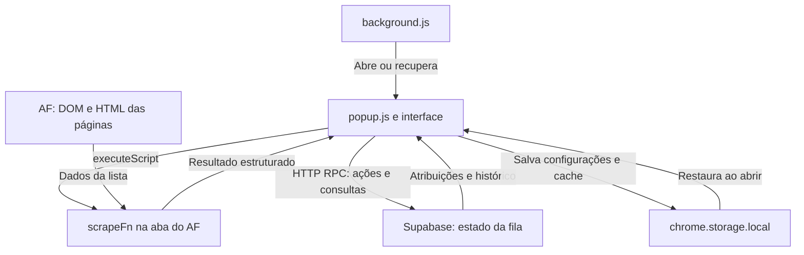
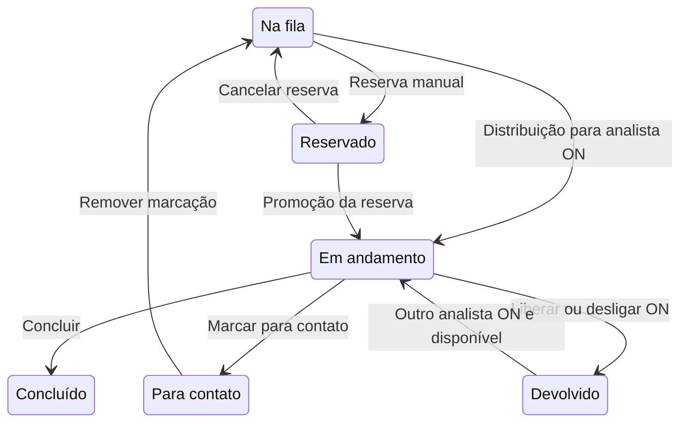

# Arquitetura de Extração, Distribuição e Apresentação de Dados
## Extensão Fila de Pedidos — Análise

**Versão de referência:** 5.3.1 · Chrome Manifest V3 · AF Mateus Mais + Supabase

Documento técnico baseado nos arquivos da extensão e nas atualizações SQL da versão 5.3.1. Segue a organização do modelo enviado: arquitetura, extração, consolidação, apresentação, ciclo de vida, decisões de projeto e referências de código. Os exemplos usam dados fictícios; os números de linha correspondem ao código analisado.

---

## 1. Visão Geral da Arquitetura

A extensão **Fila de Pedidos — Análise** lê a lista de pedidos do [AF Mateus Mais](https://af.mateusmais.com.br/), organiza os pedidos entre os analistas e apresenta o trabalho em um painel lateral ou janela própria.

O fluxo combina duas fontes de informação:

| Fonte | Informação utilizada | Forma de acesso |
|---|---|---|
| Página do AF | Pedidos, data, horário, valor, categoria, estabelecimento, modalidade, recomendação e link | Leitura do DOM e busca do HTML das páginas da mesma lista |
| Banco da fila no Supabase | Disponibilidade dos analistas, nomes reservados, atribuições, contatos, configurações e histórico | Chamadas HTTP para funções RPC |

A lista do AF informa quais pedidos foram encontrados. O banco mantém o estado compartilhado de quem está trabalhando em cada pedido. A interface cruza essas informações para exibir o pedido atual, as reservas e as pendências.

### 1.1 Componentes Principais

| Arquivo | Papel |
|---|---|
| `manifest.json` | Declara a versão, permissões, origens autorizadas, painel lateral e service worker |
| `background.js` | Abre o painel lateral; em navegadores sem essa API, abre ou recupera uma janela da extensão |
| `popup.html` | Estrutura da conexão, seleção do nome, abas, painel de pedidos e diálogos |
| `popup.js` | Orquestra leitura do AF, estado local, sincronização, distribuição e renderização |
| `popup.css` | Estilos básicos, cartões, controles, histórico e sinalização de atraso |
| `temas.js` | Catálogo, seleção, aplicação e persistência do tema por instalação |
| `temas.css` | Variáveis de cores, seis temas personalizados e estilos dos diálogos |
| `config.js` | URL e chave de API utilizadas pela conexão com o Supabase |
| `database/banco-5.3.1.sql` | Atualizações de funções e regras do banco da fila existente |
| `README.md` | Orientações de uso, atualização e descrição da versão |

O motor de leitura é a função `scrapeFn()` dentro de `popup.js`, injetada na aba do AF por `chrome.scripting.executeScript()`. O service worker cuida da abertura da interface; os ciclos de leitura e sincronização são executados por `popup.js` enquanto essa interface permanece aberta.

### 1.2 Comunicação Entre Camadas



Há três contextos distintos: o service worker, a página da extensão e o contexto de execução injetado na aba do AF. A leitura das outras páginas utiliza a sessão já aberta do usuário, com `credentials: 'same-origin'`.

### 1.3 Permissões do Navegador

| Permissão | Uso no projeto |
|---|---|
| `storage` | Configurações locais, identificador da instalação, cache, tema e ID da janela alternativa |
| `activeTab` | Acesso à aba ativa conforme as permissões concedidas pelo navegador |
| `scripting` | Injeção das funções de leitura e destaque na página |
| `sidePanel` | Painel lateral no Chrome |
| `clipboardWrite` | Cópia do link do pedido |
| Permissões de host | Acesso ao AF e ao endpoint configurado do Supabase |

O manifesto também declara permissões opcionais de origem. A interface de autorização solicita acesso para a origem do painel configurada em `local.origem`.

---

## 2. Extração de Dados

### 2.1 Localização da Aba do AF — `abaPainel()` — `popup.js:393`

A função procura a aba que contém a lista de pedidos:

1. Consulta abas da origem configurada, normalmente `https://af.mateusmais.com.br`.
2. Filtra abas cujo caminho é `/`, correspondente à lista.
3. Prefere uma aba da lista que esteja ativa; caso contrário, utiliza a primeira encontrada.
4. Como alternativa, verifica a aba ativa da janela normal em foco e depois a aba ativa da janela atual.

`ehAbaLista()` (`popup.js:412`) valida a combinação de origem e caminho. A leitura depende de uma aba acessível com a sessão do AF e a lista carregada.

### 2.2 Normalização e Reconhecimento de Texto

O código utiliza funções pequenas para padronizar os valores antes da comparação ou apresentação:

| Função | Local | Finalidade |
|---|---|---|
| `limpa()` | Interna a `scrapeFn()` | Colapsa espaços e remove espaços das extremidades |
| `semAcento()` | `popup.js:17` | Remove diacríticos e converte para minúsculas |
| `esc()` | `popup.js:14` | Escapa caracteres especiais antes de gerar HTML |
| `nomeHtml()` | `popup.js:18` | Formata o nome com a cor cadastrada e texto escapado |

Trecho de normalização usado nas comparações de lojas:

```javascript
const semAcento = (s) => String(s || '')
  .normalize('NFD')
  .replace(/[\u0300-\u036f]/g, '')
  .toLowerCase();
```

Por exemplo, `"MATEUS EXPRESS"` e `"Mateus Express"` passam a ser comparáveis. A identificação das lojas de preferência usa correspondência por trecho do nome do estabelecimento.

### 2.3 Leitura das Linhas — `scrapeFn()` — `popup.js:173`

A função interna `lerDoc(doc, base)` transforma as linhas da tabela em objetos JavaScript. O seletor principal é `#table-extended-transactions`; na ausência dele, a busca por linhas utiliza o documento recebido.

Para cada linha, o extrator:

1. Procura um link cujo texto contenha um identificador numérico de pelo menos dez dígitos.
2. Lê e normaliza o texto da linha.
3. Exige uma data e um horário no formato `DD/MM/AAAA HH:mm`.
4. Resolve o link do pedido em relação à URL da página.
5. Aceita o link somente quando utiliza HTTP/HTTPS e pertence à mesma origem da página.
6. Obtém categoria, estabelecimento e modalidade pelas posições das células.
7. Extrai o valor e a recomendação por expressões regulares.

#### Mapeamento dos Campos

| Campo | Origem | Exemplo fictício |
|---|---|---|
| `id` | Dígitos do texto do link | `"1234567890123456"` |
| `href` | Atributo `href`, resolvido e validado | `"https://af.mateusmais.com.br/pedido/exemplo"` |
| `cat` | Célula `tds[4]` | `"Varejo"` |
| `estab` | Célula `tds[5]` | `"Loja Exemplo"` |
| `modal` | Célula `tds[6]` | `"Entrega"` |
| `data` | Data convertida para `AAAA-MM-DD` | `"2026-10-21"` |
| `hora` | Horário encontrado na linha | `"10:30"` |
| `minutos` | Hora × 60 + minutos | `630` |
| `valor` | Expressão regular de valor em reais | `"R$ 150,00"` |
| `rec` | Termos de recomendação ou indicação de não analisado | `"review"` |

#### Objeto de Pedido Extraído

```json
{
  "id": "1234567890123456",
  "href": "https://af.mateusmais.com.br/pedido/exemplo",
  "cat": "Varejo",
  "estab": "Loja Exemplo",
  "modal": "Entrega",
  "data": "2026-10-21",
  "hora": "10:30",
  "minutos": 630,
  "valor": "R$ 150,00",
  "rec": "review"
}
```

A extração depende tanto de padrões de texto quanto da estrutura da tabela. Alterações na ordem das colunas do AF podem exigir revisão do mapeamento de `tds[4]`, `tds[5]` e `tds[6]`.

### 2.4 Leitura Rápida da Tela — `executarLeitura()` — `popup.js:486`

A leitura rápida executa `scrapeFn()` com `somenteTela: true`. Nesse caminho, o extrator devolve os dados já presentes no DOM, sem buscar outras páginas por HTTP.

Configuração utilizada:

```javascript
{
  ...RASPAGEM,
  somenteTela: true,
  esperaTelaMs: 1500,
  tempoTotalMs: 1800
}
```

`injetarLeitura()` (`popup.js:425`) aplica ainda um limite externo de 2.000 ms à espera do resultado. Depois de uma leitura válida, a interface atualiza o estado e pode iniciar a distribuição automática.

O ciclo `leituraContinua` tenta manter uma cadência nominal de dois segundos, descontando o tempo gasto na leitura anterior. Essa cadência se refere à consulta da tela carregada; o carregamento do AF, a rede e o agendamento do navegador continuam influenciando o tempo percebido.

#### Resultado da Leitura

```javascript
{
  ok: true,
  pedidos: [/* pedidos extraídos */],
  porPagina: { 1: [/* pedidos desta página */] },
  paginaAtual: 1,
  contexto: 'https://af.mateusmais.com.br/',
  primeira: 20,
  paginas: 3,
  totalMenu: 60
}
```

`totalMenu` é uma informação de conferência extraída do texto do menu. Uma diferença entre esse total e os pedidos lidos aparece no status, sem completar artificialmente a lista.

### 2.5 Leitura Completa com Paginação — `lerCompleto()` — `popup.js:467`

A varredura completa é iniciada separadamente. Ela permite reunir pedidos das páginas que não estão sendo exibidas na aba.

#### Parâmetros Implementados

| Parâmetro | Valor | Aplicação |
|---|---|---|
| `INTERVALO_LEITURA_MS` | 2.000 ms | Cadência nominal da leitura da tela |
| `INTERVALO_COMPLETA_MS` | 60.000 ms | Intervalo mínimo após o término da campanha completa anterior, para o mesmo contexto |
| `INTERVALO_SYNC_MS` | 2.000 ms | Espera até o próximo ciclo de banco após terminar o anterior |
| `esperaTelaMs` | 30.000 ms | Espera inicial da tabela na varredura completa |
| `tempoPaginaMs` | 60.000 ms | Limite por tentativa de busca de uma página, respeitado o prazo total |
| `tempoTotalMs` | 180.000 ms | Prazo total da varredura completa |
| `concorrencia` | 2 | Máximo de buscas de páginas em paralelo |
| `maxPaginas` | 40 | Limite da varredura |
| `esperaRetryMs` | 1.500 ms | Espera antes de uma repetição permitida |
| `TEMPO_BANCO_MS` | 35.000 ms | Limite de cada chamada RPC |

#### Etapas da Paginação

1. **Descobrir páginas:** lê links com `page=` e aceita apenas a mesma origem e o mesmo caminho da lista.
2. **Preservar filtros:** constrói a URL a partir da URL atual e altera somente o parâmetro `page`.
3. **Buscar HTML:** utiliza `fetch()` com credenciais da mesma origem e cache de rede desabilitado para a busca.
4. **Interpretar:** usa `DOMParser` e a mesma função `lerDoc()` aplicada à página visível.
5. **Expandir a campanha:** novas páginas descobertas nos resultados aumentam o conjunto de páginas a visitar.
6. **Consolidar:** elimina pedidos duplicados por ID e retorna o conjunto completo validado.

Quando não há links de paginação, o extrator sonda as próximas páginas. A sondagem encerra quando confirma que não apareceram pedidos novos. Uma resposta 404 em uma página apenas sondada pode confirmar o fim; uma resposta 404 em uma página explicitamente indicada por link é tratada como falha.

A busca admite até duas tentativas por página nos casos permitidos, como falhas transitórias e HTTP 408, 429 ou 5xx. Falhas permanentes de acesso ou sessão não seguem a mesma repetição. `AbortController` interrompe tentativas quando seus limites são atingidos.

### 2.6 Validação e Tratamento de Falhas

| Situação | Tratamento |
|---|---|
| Tela de login, senha ou redirecionamento para autenticação | Informa que a sessão do AF precisa ser restabelecida |
| Indicador de carregamento ou tabela ainda incompleta | Aguarda dentro do limite do modo de leitura |
| Lista explicitamente vazia | Aceita como resultado válido |
| Tabela realmente vazia, sem mensagem | Aplica a condição de documento carregado e espera mínima prevista no código |
| Prazo total ou de página excedido | Interrompe a operação e preserva os dados anteriormente válidos |
| Mais de 40 páginas ou fim não confirmado | Retorna erro para evitar apresentar a campanha incompleta como completa |
| Leituras repetidas na mesma aba | Compartilham a promessa em andamento para o mesmo modo de leitura |

As leituras rápida e completa usam chaves diferentes no contexto injetado. Assim, uma paginação lenta pode coexistir com novas leituras da tela.

---

## 3. Juntando os Dados e Distribuindo Pedidos

### 3.1 Estado Local, Estado Remoto e Lista Consolidada

`popup.js` mantém três grupos de informação:

| Estrutura | Conteúdo | Persistência ou origem |
|---|---|---|
| `local` | Nome selecionado, token, código da equipe, modo, data, origem, cache e compatibilidade de coordenação | `chrome.storage.local` |
| `remote` | Analistas, atribuições, configurações, nomes em uso e condição de coordenação | RPC `fila_estado` |
| `pedidos` / `paginasLidas` | Lista extraída e resultados organizados por página/contexto | Memória, com cache local |

O token da instalação é gerado com `crypto.randomUUID()` quando ainda não existe. Ele associa aquela instalação ou perfil do navegador à reserva de um nome no banco.

### 3.2 Consolidação das Leituras — `aplicarLeitura()` — `popup.js:440`

A consolidação utiliza a URL da lista sem `page`, com parâmetros ordenados e sem fragmento, como identificador de contexto.

O processo:

1. Descarta a organização de páginas anterior quando o contexto muda.
2. Atualiza somente a página correspondente no caso de leitura rápida.
3. Aplica o conjunto de páginas no caso de leitura completa.
4. Preserva uma leitura rápida de página que tenha ocorrido depois do início da campanha completa.
5. Elimina duplicações pelo ID usando `Map`.
6. Ordena pedidos por `data + hora + id`.
7. Atualiza os indicadores de completude e o cache.
8. Persiste o cache quando a assinatura dos dados relevantes mudou.

`lerCompleto()` também confere o contexto antes de aplicar o resultado. Uma resposta de um filtro antigo não substitui os dados do filtro novo.

### 3.3 Comunicação com o Banco — `rpc()` — `popup.js:59`

As chamadas usam POST para `/rest/v1/rpc/<função>`. O corpo inclui os parâmetros comuns da equipe e da instalação, além dos argumentos da operação.

Exemplo estrutural, com identificadores substituídos:

```javascript
{
  p_codigo: '<codigo-da-equipe>',
  p_token: '<identificador-da-instalacao>',
  p_coord: null,
  p_analista: 'Gabriel',
  p_pedido_id: '1234567890123456',
  p_acao: 'contato',
  p_candidatos: []
}
```

`config.js` fornece `SUPABASE_URL` e `SUPABASE_KEY`. `rpc()` acrescenta os cabeçalhos de API e autorização, interpreta a resposta e transforma falhas HTTP ou limite de tempo em mensagens para a interface.

`sync()` reutiliza uma sincronização em andamento. `sincronizar()` aplica a resposta de `fila_estado` e verifica a reserva do nome. O retorno dos usuários contém `nome` e `meu`, permitindo que cada instalação reconheça a própria reserva sem receber os tokens das outras instalações.

### 3.4 Estruturas do Banco da Fila

| Tabela | Responsabilidade |
|---|---|
| `fila_analistas` | Cadastro operacional dos analistas, disponibilidade ON e horários |
| `fila_usuarios` | Associação entre nome e token da instalação |
| `fila_atribuicoes` | Pedido, analista, estado e dados de apoio da atribuição |
| `fila_config` | Código da equipe e configurações compartilhadas, como janela e lojas de preferência |
| `fila_historico` | Registros de ações com ator, analista relacionado, pedido, data e detalhe |

Uma atribuição utiliza campos como `pedido_id`, `analista`, `status`, `hora`, `valor`, `estab`, `href`, `categoria`, `criado_em` e `atualizado_em`. A categoria recebida do extrator como `cat` é gravada no banco como `categoria`.

O arquivo `database/banco-5.3.1.sql` contém atualizações sobre uma estrutura já existente. Ele depende das tabelas, índices e funções de autorização previamente implantados; não é um script autossuficiente de criação de todo o banco.

### 3.5 Seleção dos Candidatos — `candidatosAuto()` — `popup.js:636`

A interface prepara a lista de pedidos que o banco poderá considerar:

1. Coloca as lojas de preferência à frente dos demais pedidos.
2. Seleciona até 500 pedidos considerados disponíveis no estado local.
3. Acrescenta dados dos pedidos atuais, reservados ou devolvidos que estejam na leitura, para apoiar a atualização de seus metadados.
4. Remove duplicações por ID.
5. Limita a lista final a 1.000 entradas.

Cada candidato transporta `id`, `hora`, `valor`, `estab`, `href`, `cat` e o indicador booleano `preferencia`.

`ocupados()` considera os IDs das atribuições com estado diferente de `devolvido`. Pedidos em contato, reservados, atuais ou concluídos continuam separados dos novos candidatos livres enquanto suas atribuições existirem. O banco faz a verificação definitiva antes de atribuir um pedido.

### 3.6 Distribuição Automática ao Marcar ON

No cliente, `distribuirAutomatico()` (`popup.js:651`) verifica se há conexão válida, nome selecionado, disponibilidade ON, leitura válida, analista livre e trabalho a distribuir. A chamada periódica não prossegue enquanto há uma ação, troca de nome ou outra distribuição em andamento.

Ao marcar ON pela interface:

1. Salva a disponibilidade com `fila_set_analista`.
2. Seleciona a aba Pilha.
3. Chama `fila_distribuir_auto` com os candidatos.
4. Reconsulta o estado caso o banco tenha distribuído pedidos.

O banco usa `fila_auto_alocar()` (`banco-5.3.1.sql:119`) em três etapas:

| Ordem | Grupo | Critério |
|---|---|---|
| 1 | Reservas manuais | Promove a reserva mais antiga do próprio analista ON, identificado e sem pedido atual |
| 2 | Pedidos devolvidos | Sorteia outro analista ON, identificado, elegível e sem pedido atual |
| 3 | Novos candidatos | Prioriza o analista indicado pela operação; ordena os demais livres aleatoriamente e respeita a ordem dos candidatos |

Para pedidos novos, a preferência da loja vem antes da ordem recebida do cliente, que já está organizada por antiguidade. O algoritmo não implementa uma fila circular fixa de analistas.

**Força de Vendas:** pedidos reconhecidos pela categoria ou estabelecimento ficam restritos a Cássio e Gabriel. Para certas devoluções antigas desses dois analistas sem categoria preenchida, o banco aplica uma restrição conservadora até obter metadados suficientes.

### 3.7 Concluir, Liberar e Buscar o Próximo — `fila_avancar()`

`avancarPedido()` (`popup.js:672`) envia a ação, o analista do pedido e o ID exato exibido. `fila_avancar()` (`banco-5.3.1.sql:271`) valida a operação e realiza a alteração e a próxima distribuição na mesma transação.

| Ação | Estado produzido | Efeito no fluxo |
|---|---|---|
| `concluir` | `concluido` | Registra a conclusão e tenta entregar o próximo ao analista |
| `liberar` | `devolvido` | Devolve para redistribuição a outro analista elegível; o liberador pode receber outro pedido |
| `contato` | `contato` | Separa para contato e tenta entregar o próximo ao analista do pedido |

Se não há pedido atual com o ID e o analista esperados, a função devolve `ja_processado: true`. Isso impede que um clique repetido no pedido anterior consuma o pedido seguinte.

O botão **Liberar** mantém o pedido devolvido com a referência ao último analista. O sorteio exclui esse nome. Se os outros elegíveis estiverem OFF ou ocupados, a atribuição permanece em `devolvido` aguardando oportunidade.

Desligar ON pela interface chama `fila_liberar`, que também devolve o pedido atual à fila. Essa operação é diferente de liberar apenas a reserva do nome.

### 3.8 Contatos Compartilhados — Versão 5.3.1

Qualquer analista com nome escolhido pode marcar o pedido atual de outro analista para contato e remover uma marcação de contato existente. Estar ON não é requisito para editar contato.

A autorização é aplicada em dois pontos:

- **Interface:** `podeEditarContato()` (`popup.js:156`) mostra os controles aos analistas identificados e à coordenação compatível.
- **Banco:** `fila_avancar` permite a ação `contato` entre analistas; `fila_devolver` permite remover contato de outro analista.

`fila_devolver()` (`banco-5.3.1.sql:316`) lê e bloqueia a atribuição antes da operação. Para um contato, remove a atribuição da lista de contato e registra `removeu_de_contato`. O pedido volta a ser elegível como entrada livre, quando presente nos candidatos de uma distribuição.

Para `reservado`, essa mesma função exige a autorização do proprietário ou da coordenação. Concluir e liberar pedidos atuais também mantêm a autorização do analista responsável ou da coordenação.

O histórico diferencia **ator da ação** e **analista relacionado ao pedido**. Assim, Abigail pode marcar um pedido de Gabriel e Rayla pode remover a marcação, mantendo os três papéis identificáveis nos registros.

### 3.9 Estados do Pedido



**Na fila** é uma situação lógica: um pedido lido do AF sem atribuição que o bloqueie. Os estados persistidos aceitos pelo banco são `em_andamento`, `concluido`, `contato`, `reservado` e `devolvido`.

---

## 4. Apresentação dos Dados

### 4.1 Abertura da Interface — `background.js`

| Ambiente | Comportamento |
|---|---|
| Navegador com `chrome.sidePanel.setPanelBehavior` | Configura o ícone para abrir o painel lateral |
| Navegador sem essa API, como o cenário alternativo previsto para Opera GX | Abre uma janela `popup` com 450 × 820 pixels |
| Janela alternativa já existente | Recupera o ID salvo em `janelaId` e tenta focar essa janela |

As duas formas carregam `popup.html` e utilizam o mesmo código de interface.

### 4.2 Conexão e Identificação

A interface apresenta o código da equipe, a situação de acesso à origem do painel e o seletor **Eu sou**.

`renderEu()` (`popup.js:745`) mostra os oito nomes cadastrados no cliente: Natalie, Cássio, Evangela, Gabriel, Kazaf, Rayla, Abigail e Alisson. Um nome reservado por outra instalação aparece como **em uso** e fica desabilitado.

`escolherNome()` envia a escolha explicitamente ao banco. `garantirNome()` restaura uma reserva pertencente ao token atual ou limpa a seleção local quando a reserva foi liberada. Uma instalação nova não assume automaticamente um nome apenas porque ele estava salvo anteriormente.

Há dois usos distintos da palavra **Liberar**:

| Controle | Função | Resultado |
|---|---|---|
| Liberar ao lado do nome | `fila_liberar_nome` | Torna o nome disponível para nova escolha |
| Liberar no cartão do pedido | `fila_avancar`, ação `liberar` | Devolve o pedido atual para outro analista elegível |

O campo de código de coordenação foi removido da tela. O parâmetro interno `p_coord` e a leitura de `remote.coord` continuam presentes para compatibilidade com o backend existente.

### 4.3 Aba Pilha — `renderPilha()` — `popup.js:820`

A aba Pilha é o modo padrão da versão analisada. Ela exibe:

- Total de pedidos livres, quantidade de preferência e quantidade de Força de Vendas.
- Cartões dos analistas ON, com o próprio analista em primeiro plano.
- Pedido atual, horário, valor, estabelecimento, recomendação e modalidade quando disponíveis.
- Ações de concluir, marcar para contato e liberar conforme as permissões.
- Reservas manuais e lista compartilhada de contatos.
- Quantidade de devolvidos aguardando outro analista disponível.
- Alguns pedidos concluídos que saíram da lista, conforme as condições de leitura.

A distribuição automática substitui o antigo botão **Pegar meu pedido**. Quando não há atribuição, o cartão informa que aguarda pedido disponível.

A indicação de que um pedido saiu da lista depende de uma leitura válida e completa. A ação de concluir registra o trabalho no controle da fila; a função apresentada aqui não executa uma aprovação ou recusa do pedido no AF.

### 4.4 Aba Intervalo — `renderIntervalo()` — `popup.js:803`

A aba Intervalo organiza a apresentação por faixas de horário:

1. `janela()` lê início, duração e modo automático da configuração compartilhada.
2. `faixas()` divide a janela entre os analistas ON ou utiliza as faixas manuais.
3. `porIntervalo()` filtra os pedidos pela data selecionada e encontra a faixa correspondente pelo campo `minutos`.
4. A interface mostra os pedidos do analista selecionado e os pedidos sem faixa correspondente.

Essa classificação por horário é uma visualização calculada no cliente. As atribuições individuais da Pilha são registradas no banco por suas próprias operações.

### 4.5 Abrir, Copiar e Localizar um Pedido

| Ação | Implementação | Comportamento |
|---|---|---|
| Abrir | `abrir()` — `popup.js:530` | Procura o link na leitura ou na atribuição e abre nova guia |
| Localizar | `destacar()` / `highlightFn()` | Destaca a linha do pedido na página e rola até ela |
| Copiar | `copiar()` — `popup.js:536` | Usa a área de transferência; possui alternativa com campo temporário |

`highlightFn()` limpa os destaques anteriores feitos pela extensão antes de aplicar o novo contorno e fundo na linha encontrada.

### 4.6 Histórico — Botão Minimalista `i`

O diálogo de histórico é aberto por `abrirHist()` (`popup.js:950`). `carregarHist()` (`popup.js:922`) consulta `fila_historico_pagina`.

| Campo do registro | Significado |
|---|---|
| `id` | Identificador usado também como cursor de paginação |
| `quando` | Data e hora do registro |
| `ator` | Quem acionou a operação |
| `coord` | Indicador de ação com condição de coordenação |
| `acao` | Tipo de operação registrada |
| `analista` | Analista relacionado ao pedido ou à operação |
| `pedido_id` | Pedido afetado, quando aplicável |
| `detalhe` | Contexto adicional, como redistribuição após liberação |

A interface solicita 100 registros por página. O backend aceita entre 1 e 250, usa `id < p_antes` para buscar registros anteriores e oferece filtros por analista, ação e trecho do ID do pedido.

O botão **Carregar ações anteriores** permite continuar a consulta. Quando o diálogo está aberto e exibe até 100 registros, o ciclo de sincronização pode renovar o histórico após aproximadamente dez segundos. Ao carregar mais páginas, essa renovação automática é evitada pelo código para preservar a navegação.

Nas distribuições automáticas, a apresentação identifica quem recebeu o pedido e, quando diferente, quem acionou a distribuição.

### 4.7 Temas por Instalação — `temas.js`

O botão de paleta abre um diálogo com sete opções:

| Opção | ID | Classe CSS |
|---|---|---|
| Padrão | `padrao` | Sem classe de tema personalizada |
| Homem Aranha | `homem-aranha` | `tema-homem-aranha` |
| Game of Thrones | `got` | `tema-got` |
| Segurança / Cyber | `seguranca` | `tema-seguranca` |
| Homem de Ferro | `homem-de-ferro` | `tema-homem-de-ferro` |
| Dark Puro | `dark-puro` | `tema-dark-puro` |
| Caveiras / Punisher | `caveiras` | `tema-caveiras` |

`aplicar()` (`temas.js:19`) ajusta a classe no elemento raiz `document.documentElement`. `temas.css` utiliza variáveis como `--bg-principal`, `--bg-card`, `--cor-texto`, `--btn-principal`, `--btn-destaque` e `--borda-fina`.

A escolha fica em uma chave própria do armazenamento local:

```json
{
  "filaPreferenciasVisuais": {
    "tema": "homem-aranha"
  }
}
```

`escolher()` (`temas.js:37`) aplica imediatamente, salva e restaura o tema anterior se o salvamento falhar. O código também evita que uma leitura antiga do armazenamento desfaça uma escolha mais recente.

O tema pertence à instalação ou perfil do navegador. Ele é independente da reserva do nome e não é enviado ao banco nem ao `chrome.storage.sync`. As variáveis de tema alteram a aparência, mantendo os parâmetros de leitura e distribuição definidos no código.

### 4.8 Status e Sinalização de Atraso

`renderStatus()` (`popup.js:715`) informa conexão com o banco, horário da sincronização, quantidade de pedidos, uso de cache, progresso da leitura e problemas de acesso ao AF.

O limite `LIMITE_ATRASO_MS` é de 30 minutos. `atrasado()` compara o horário de criação da atribuição com o horário atual. Os cartões e itens recebem a classe `atraso`, que produz a sinalização visual. A folha de temas respeita `prefers-reduced-motion`, desativando a animação quando solicitado pelo ambiente.

---

## 5. Resumo do Ciclo de Vida Completo

### 5.1 Inicialização

1. O usuário abre a extensão pelo ícone.
2. `background.js` utiliza o painel lateral ou a janela alternativa.
3. O HTML carrega os estilos, `temas.js`, `config.js` e `popup.js`.
4. `loadLocal()` restaura configurações e a última lista válida, quando disponível.
5. `renderTudo()` mostra a interface antes de depender das respostas de rede.
6. Os eventos de botões e abas são registrados.
7. São iniciados dois ciclos independentes: leitura do AF e sincronização do banco.

### 5.2 Operação Contínua

| Ciclo | Sequência | Agendamento |
|---|---|---|
| Leitura da tela | Localiza aba → injeta leitura rápida → consolida → renderiza → avalia distribuição e leitura completa | Tenta manter o período nominal de dois segundos |
| Banco | Consulta estado → reconcilia nome → avalia distribuição → atualiza interface e histórico quando aplicável | Aguarda dois segundos após terminar o ciclo anterior |
| Paginação completa | Busca outras páginas → valida → consolida sem sobrescrever leituras mais novas | Campanha separada, com nova elegibilidade após 60 segundos do término anterior no mesmo contexto |

Eventos de ativação da aba e término de navegação também podem antecipar uma leitura. O botão **Ler página** solicita leitura e sincronização em paralelo.

### 5.3 Exemplo de Trabalho Compartilhado

1. Gabriel escolhe seu nome e marca ON.
2. A interface envia os candidatos e o banco atribui um pedido elegível.
3. Gabriel conclui o pedido; a mesma transação registra a conclusão e procura o próximo.
4. Abigail marca o pedido seguinte de Gabriel para contato; o histórico registra Abigail como autora e Gabriel como analista do pedido.
5. Rayla remove essa marcação; o pedido retorna à condição de fila livre quando estiver disponível para uma nova distribuição.
6. Em outra operação, Gabriel utiliza **Liberar**. O pedido entra em `devolvido` e aguarda um outro analista ON e disponível, escolhido aleatoriamente entre os elegíveis.
7. As instalações abertas reconsultam o banco e passam a mostrar o novo estado.

### 5.4 Fechamento e Retomada

Fechar a interface encerra os ciclos executados por aquela instância de `popup.js`. Ao reabrir, a extensão recupera o armazenamento local e consulta novamente o estado compartilhado.

O estado ON é persistido no banco e não é desligado automaticamente pelo fechamento da janela. Outra instalação ativa pode continuar distribuindo pedidos para um nome que permaneça ON. A disponibilidade deve ser desligada explicitamente na interface quando necessário.

---

## 6. Principais Decisões de Projeto

### 6.1 Tela Rápida Separada da Paginação

A leitura da página visível precisa continuar mesmo quando as demais páginas demoram. Por isso, o código mantém promessas e limites separados para leitura rápida e leitura completa. A consulta rápida utiliza o DOM já carregado e a campanha completa busca o restante do HTML.

A cadência nominal de dois segundos não representa uma garantia de atualização de todas as páginas ou de resposta do servidor do AF nesse prazo.

### 6.2 Banco como Autoridade das Atribuições

A interface oferece os candidatos e apresenta os resultados. O banco valida a identidade da instalação, a ação e a situação do pedido antes de efetivar alterações.

O fluxo implantado utiliza a identificação por código da equipe e token vinculado a um nome, com funções de autorização como `fila_ator` e `fila_autoriza`. A reserva representa uma instalação identificada; por si só, ela não comprova a identidade pessoal de quem utiliza o computador.

As operações de atribuição contam com a unicidade do pedido e a restrição de um pedido atual por analista na estrutura existente. O alocador também utiliza `ON CONFLICT(pedido_id) DO NOTHING`.

### 6.3 Concorrência e Cliques Repetidos

| Camada | Proteção |
|---|---|
| Leitura injetada | Reutilização da promessa da leitura em andamento por modo |
| Cliente | `leituraEmCurso`, `completaEmCurso`, `syncEmCurso`, `acaoEmCurso` e `distribuicaoEmCurso` |
| Ações na interface | Desabilitação temporária de controles e espera de distribuição em andamento |
| Banco: nomes | Bloqueio transacional consultivo com chave `(802153, 510)` |
| Banco: distribuição e contato | Bloqueio transacional consultivo com chave `(802153, 530)` e bloqueio das linhas necessárias |
| Avançar pedido | Conferência do ID esperado, analista e estado atual antes da mudança |

As proteções do cliente evitam chamadas redundantes na mesma instalação. As proteções do banco coordenam operações vindas de várias máquinas.

### 6.4 Preferência, Reserva e Redistribuição

A prioridade das reservas manuais protege uma escolha explícita de pedido para um analista. Lojas de preferência passam à frente dos outros candidatos novos. A devolução por **Liberar** usa um estado próprio e registra quem liberou antes de tentar o sorteio de outro destinatário.

O sorteio respeita disponibilidade, ausência de pedido atual, nome escolhido e elegibilidade para Força de Vendas. Se não houver destino possível, o estado `devolvido` continua aguardando no banco.

### 6.5 Permissões de Contato Separadas das Outras Ações

A versão 5.3.1 compartilha a marcação e a remoção de contato entre analistas identificados. As operações de concluir, liberar pedido atual, alterar os dados individuais de outro analista e cancelar reserva alheia conservam suas regras próprias de autorização.

A condição visual que apresenta o botão e a validação no banco são camadas independentes. O servidor precisa validar a operação mesmo quando o cliente já esconde ou desabilita um controle.

### 6.6 Cache, Completude e Histórico

Uma leitura inválida mantém os últimos dados válidos, acompanhados do status de cache ou erro. O cliente suspende a distribuição periódica automática quando está usando uma leitura inválida em cache.

O banco separa o histórico de ações das atribuições operacionais. Na versão documentada, `fila_estado` possui uma limpeza oportunista: em aproximadamente 3% das chamadas, remove atribuições `concluido` com atualização anterior a dois dias. Essa rotina não apaga os registros de `fila_historico`.

Assim, uma atribuição concluída pode deixar a lista operacional e continuar documentada no histórico. A consulta do histórico utiliza páginas por cursor para permitir acesso a registros anteriores.

### 6.7 Aparência Local e Regras Compartilhadas

| Informação | Escopo |
|---|---|
| Tema selecionado | Instalação ou perfil do navegador |
| Cache, modo de exibição e data selecionada | Instalação ou perfil do navegador |
| Token da extensão | Instalação ou perfil do navegador |
| Reserva de nome | Compartilhada no banco, vinculada ao token |
| Disponibilidade ON e horários operacionais | Compartilhados no banco |
| Pedidos atuais, reservas, contatos e devoluções | Compartilhados no banco |
| Lojas de preferência e configuração da janela | Compartilhadas no banco |
| Histórico de ações | Compartilhado no banco |

Trocar de nome na mesma instalação não redefine automaticamente o tema. Outra máquina pode escolher uma aparência própria mesmo que venha a utilizar o mesmo nome em outro momento.

### 6.8 Segurança na Apresentação e no Acesso

Os textos utilizados no HTML passam por `esc()`. O extrator valida a origem dos links obtidos da lista. O catálogo de temas é fixo e seus IDs são conferidos antes da aplicação.

As RPCs da versão documentada validam a equipe e o ator antes de alterar a fila. O alocador interno e a função de gravação de auditoria têm execução direta revogada para os papéis de cliente. As RPCs expostas permanecem responsáveis pela autorização de cada ação.

O documento descreve o fluxo de acesso da versão analisada; ele não substitui uma auditoria de todas as tabelas e funções existentes no projeto Supabase. Não são reproduzidos valores de chaves, códigos da equipe nem tokens de instalações.

### 6.9 Mudanças no Banco e Mudanças nos Arquivos

| Tipo de alteração | Onde precisa ser feita | Efeito nas instalações existentes |
|---|---|---|
| Liberar um nome em uso | Banco | A consulta seguinte pode mostrar o nome disponível |
| Alterar a lógica de uma RPC existente, mantendo seu contrato | Banco | Vale nas próximas chamadas feitas pelos clientes compatíveis |
| Ajustar autorizações de uma operação já exposta pelo cliente | Banco; a interface também precisa permitir acionar a operação | A autorização pode mudar imediatamente; controles ocultos continuam seguindo o código instalado |
| Mostrar um botão que a versão antiga ocultava | Arquivo JavaScript/HTML da extensão | Exige atualizar os arquivos locais ou usar um mecanismo de atualização da extensão |
| Alterar temas disponíveis, seletores do AF ou constantes de tempo | Arquivos da extensão, na arquitetura atual | Exige atualização do cliente |
| Novos controles remotos de interface | Implementação prévia no cliente e contrato correspondente no backend | Depende de evolução da arquitetura; não existe um mecanismo genérico implementado nesta versão |

No caso dos contatos compartilhados, a regra de autorização foi ajustada no banco. A versão 5.3.1 também alterou os controles visuais para apresentar os botões de contato aos outros analistas. Um cliente antigo que esconde esses botões não passa a mostrá-los apenas porque o servidor passou a aceitar a ação.

Atualizar os arquivos na mesma instalação e recarregar a extensão é diferente de remover a instalação. A preservação das configurações depende de manter a mesma instalação e seu armazenamento local.

### 6.10 Verificações Disponíveis no Projeto

| Arquivo de teste | Cobertura principal |
|---|---|
| `tests/test-extension.cjs` | Leitura, paginação, duplicações, prazo total, erros HTTP e sessão do AF |
| `tests/test-ui-510.cjs` | Seleção exclusiva de nomes, instalações diferentes, histórico, cache e concorrência |
| `tests/test-ui-530.cjs` | ON automático, próximo pedido, devolução, recuperação de falhas e painel com muitos pedidos |
| `tests/test-contato-compartilhado.cjs` | Marcação e remoção entre analistas, controles por identidade e autoria do histórico |
| `database/tests/test-fila-5.3.sql` | Distribuição, devolução, prioridade, idempotência e autorização no banco |
| `database/tests/test-contato-compartilhado.sql` | Contato compartilhado, repetição de ações e manutenção das outras autorizações |

Os testes de interface utilizam simulações de DOM, rede e APIs do navegador. Os roteiros de banco foram construídos com transação e reversão dos dados temporários. Esses arquivos são recursos de verificação do projeto e não fazem parte dos arquivos necessários para carregar a extensão.

A conferência visual com uma sessão autenticada real do AF continua sendo uma etapa distinta dessas verificações automatizadas.

---

## 7. Referências de Código

As tabelas abaixo apontam para o início das funções na versão 5.3.1. Os números de linha podem mudar em versões posteriores.

### 7.1 `popup.js` — Extração e Consolidação

| Função / bloco | Linha | Responsabilidade |
|---|---|---|
| `esc` | 14 | Escapa texto para apresentação HTML |
| `semAcento` | 17 | Normaliza texto para comparações |
| `scrapeFn` | 173 | Extrai a tela e executa a paginação |
| `highlightFn` | 372 | Localiza e destaca linhas no AF |
| `abaPainel` | 393 | Seleciona a aba da lista |
| `ehAbaLista` | 412 | Valida origem e caminho da lista |
| `lerPedidos` | 419 | Compartilha uma leitura em andamento |
| `injetarLeitura` | 425 | Injeta o extrator e limita a espera |
| `aplicarLeitura` | 440 | Consolida páginas, versões e cache |
| `lerCompleto` | 467 | Orquestra a campanha de paginação |
| `executarLeitura` | 486 | Executa a leitura rápida e aciona os fluxos seguintes |
| `ler` | 506 | Solicita leitura e sincronização em paralelo |

### 7.2 `popup.js` — Estado, Regras e Ações

| Função / bloco | Linha | Responsabilidade |
|---|---|---|
| `loadLocal` | 43 | Restaura o estado local e prepara o token |
| `saveLocal` | 42 | Persiste o estado desta instalação |
| `rpc` | 59 | Chama as funções HTTP do banco |
| `sync` | 82 | Evita sincronizações simultâneas redundantes |
| `sincronizar` | 88 | Aplica o estado compartilhado |
| `garantirNome` | 115 | Reconcilia a reserva do nome |
| `escolherNome` | 128 | Escolhe ou libera o nome explicitamente |
| `podeAgirEm` | 155 | Controla ações individuais na interface |
| `podeEditarContato` | 156 | Permite os controles compartilhados de contato |
| `ocupados` | 159 | Obtém IDs ocupados, exceto devolvidos |
| `prefLojas` | 163 | Recupera as lojas de preferência |
| `ehFV` | 553 | Reconhece Força de Vendas no cliente |
| `livresPara` | 556 | Seleciona candidatos para o fluxo de compatibilidade |
| `janela` | 572 | Lê a configuração de horário |
| `faixas` | 577 | Calcula as faixas dos analistas |
| `porIntervalo` | 598 | Agrupa os pedidos pela faixa |
| `acao` | 613 | Serializa ações iniciadas pela interface |
| `candidatosAuto` | 636 | Monta o conjunto para distribuição |
| `sincronizarAposAcao` | 646 | Garante consulta de estado após a operação |
| `distribuirAutomatico` | 651 | Dispara a distribuição compartilhada |
| `avancarPedido` | 672 | Envia ação e ID exato do pedido |
| `concluirEPuxar` | 677 | Atalho para concluir e buscar o próximo |
| `liberarEPuxar` | 678 | Atalho para devolver e buscar outro |
| `acharEntrada` | 681 | Interpreta ID ou link de pedido informado |
| `anexarManual` | 693 | Solicita a reserva de um pedido |

### 7.3 `popup.js` — Apresentação e Ciclos

| Função / bloco | Linha | Responsabilidade |
|---|---|---|
| `item` | 707 | Gera a apresentação de um pedido |
| `renderStatus` | 715 | Exibe conexão, leitura, cache e erros |
| `renderEu` | 745 | Apresenta nomes disponíveis e em uso |
| `renderUsos` | 760 | Apresenta reservas de nomes |
| `renderCfg` | 768 | Monta configurações e disponibilidade |
| `renderIntervalo` | 803 | Apresenta pedidos por faixa de horário |
| `renderPilha` | 820 | Apresenta cartões, reservas e contatos |
| `renderPainel` | 882 | Seleciona a visualização ativa |
| `renderTudo` | 887 | Atualiza os componentes da interface |
| `renderHist` | 911 | Apresenta os registros de ações |
| `carregarHist` | 922 | Consulta e pagina o histórico |
| `abrirHist` | 950 | Abre o diálogo de histórico |
| `DOMContentLoaded` | 966 | Inicialização e registro de eventos |
| `atualizar` | 1138 | Ciclo de sincronização com o banco |
| `leituraContinua` | 1155 | Ciclo de leitura rápida do AF |

### 7.4 `database/banco-5.3.1.sql` — Atualizações do Backend

| Função / bloco | Linha | Responsabilidade |
|---|---|---|
| `fila_escolher_nome` | 4 | Escolha explícita e exclusiva de nome |
| `fila_assumir_nome` | 31 | Compatibilidade sem assumir nomes liberados automaticamente |
| `fila_liberar_nome` | 42 | Liberação da reserva de um nome |
| `fila_historico_pagina` | 61 | Histórico com filtros e cursor |
| `fila_estado` | 87 | Consulta compartilhada e limpeza operacional prevista |
| `fila_auto_alocar` | 119 | Reservas, devolvidos e candidatos novos |
| `fila_distribuir_auto` | 186 | Entrada autorizada da distribuição automática |
| `fila_liberar_pedido` | 203 | Devolução para clientes anteriores |
| `fila_liberar` | 217 | Devolução do pedido ao desligar ON |
| `fila_puxar` | 232 | Fluxo de compatibilidade e reserva manual |
| `fila_avancar` | 271 | Conclusão, devolução ou contato com ID esperado |
| `fila_contato` | 301 | Marcação de contato na assinatura de compatibilidade |
| `fila_devolver` | 316 | Remoção de contato ou cancelamento de reserva autorizado |

### 7.5 `temas.js` — Personalização Local

| Função / bloco | Linha | Responsabilidade |
|---|---|---|
| `aplicar` | 19 | Ajusta classe CSS e estado dos controles |
| `mensagem` | 32 | Mostra resultado do salvamento |
| `escolher` | 37 | Salva o tema e trata falhas |
| `abrir` | 56 | Abre o diálogo de personalização |
| `fechar` | 65 | Fecha o diálogo e devolve o foco |
| `iniciar` | 73 | Cria opções, recupera o tema e observa mudanças locais |

### 7.6 Arquivos Complementares

| Arquivo | Ponto de consulta |
|---|---|
| `background.js` | Seleção entre painel lateral e janela alternativa; recuperação de `janelaId` |
| `popup.html` | IDs dos controles, abas, diálogos de histórico e tema, e ordem dos scripts |
| `popup.css` | Estrutura visual e animação básica de atraso |
| `temas.css` | Paletas, variáveis, amostras e comportamento com movimento reduzido |
| `manifest.json` | Versão 5.3.1, permissões, service worker e painel lateral |
| `config.js` | Configuração da conexão; valores não reproduzidos neste documento |
| `README.md` | Procedimento de uso e atualização da extensão |

---

**Base desta documentação:** código local da extensão Fila de Pedidos — Análise 5.3.1 e SQL de atualização correspondente. O arquivo de arquitetura enviado foi utilizado como referência de estrutura. Este documento não altera a extensão nem publica mudanças no banco.
