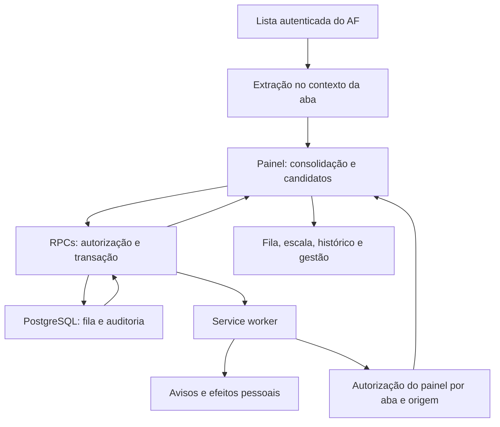
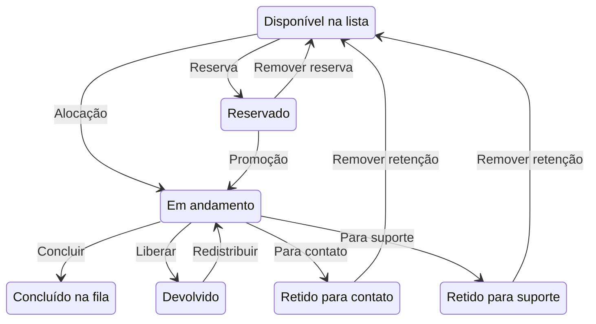

# Arquitetura de extração, distribuição e apresentação

## AF Operação — versão 6.8.1

Este documento atualiza o modelo da versão 5.3.1: arquitetura, extração, consolidação, apresentação, ciclo de vida, decisões e referências. As referências usam arquivos e símbolos, sem números de linha que envelhecem a cada edição. A leitura do código desta versão é a fonte para os detalhes do cliente; o SQL incluído é incremental e não representa sozinho todo o backend implantado.

## 1. Visão geral da arquitetura

A extensão lê a lista autenticada do AF Mateus Mais, envia candidatos a RPCs e apresenta o estado compartilhado. A página AF é a fonte da lista; o PostgreSQL é a autoridade das atribuições e permissões. O cliente não aprova ou rejeita compras no AF: concluir uma tarefa na fila é uma operação de organização da extensão.



### 1.1 Contextos de execução

| Contexto | Responsabilidade | Persistência |
|---|---|---|
| Service worker | Abertura, mensagens, consulta de avisos/efeitos e autorização global | Pode ser suspenso pelo navegador; dados duráveis ficam no storage/banco |
| Documento da extensão | Estado da tela, raspagem solicitada, RPCs, gestão e renderização | Ciclos ativos enquanto a instância está carregada |
| Script injetado no AF | Leitura/destaque no DOM, com sessão existente | Ligado à aba e ao documento AF |
| Scripts em outros sites | Ícone, host flutuante e efeitos permitidos | Não extraem os pedidos desses sites |
| Backend | Autorização, distribuição, retenção, descanso e auditoria | Compartilhado entre instalações |

### 1.2 Componentes

| Arquivos | Função |
|---|---|
| `manifest.json`, `background.js` | Entradas Manifest V3, permissões, painel lateral e janela alternativa |
| `popup.html`, `popup.js`, `popup.css`, `cliente.css` | Interface, extração, cache, candidatos e operações |
| `gestao.js`, `gestao.css` | Gestão, status, rotas, escala, importação, avisos e relatórios |
| `escala-importar.js`, `vendor/` | Reconhecimento local de XLS/XLSX/CSV/PDF e OCR |
| `aparencia.js`, `catalogo-temas.js`, `temas.js`, `temas.css` | Paletas, validação, catálogo, preferência e estilos locais |
| `avisos-background.js`, `af-notificacoes.js`, `baloes.js` | Consulta autenticada e projeção de avisos sem credenciais nas páginas |
| `efeito-core.js`, `pedido-background.js`, `pedido-animacao.js` | Seleção, consumo único e renderização de efeitos pessoais |
| `painel-flutuante.js` | Hover, recolhimento e restauração após atualização/redesenho |
| `painel-global-background.js`, `painel-global-host.js`, `painel-global.html`, `painel-global.js` | Registro opcional e entrada protegida do painel em outros sites |
| `sidebar-injetada.js`, `sidebar-injetada.css` | Recursos auxiliares de sidebar; não são uma nova fonte de pedidos |
| `config.js` | Configuração local da conexão; ignorada pelo Git |

## 2. Extração de dados

### 2.1 Localização da lista

`abaPainel()` e `ehAbaLista()` selecionam uma aba na origem AF configurada e no caminho de lista. `chrome.scripting.executeScript()` executa `scrapeFn()` no contexto isolado da aba. A sessão AF deve estar válida. A extração usa o HTML disponível e requisições da mesma origem, sem solicitar a senha do AF.

### 2.2 Reconhecimento de linhas

`lerDoc()`, interna a `scrapeFn()`, usa `#table-extended-transactions` quando disponível, percorre linhas e procura um link com pelo menos dez dígitos e data/hora reconhecível. Espaços são normalizados. Links só são aceitos quando pertencem à mesma origem e usam HTTP/HTTPS.

| Campo | Origem/forma atual |
|---|---|
| `id` | Dígitos do texto do link |
| `href` | Link absoluto validado na mesma origem |
| `data`, `hora`, `minutos` | Data e hora encontradas no texto; data em `AAAA-MM-DD` |
| `cat`, `estab`, `modal` | Células de índices 4, 5 e 6 da linha |
| `valor` | Texto monetário `R$` reconhecido na linha |
| `rec` | approve/review/reject/deny/decline ou “não analisado” |

Exemplo fictício do contrato de leitura:

```json
{"id":"2026102400000001","href":"https://af.mateusmais.com.br/pedido/exemplo","data":"2026-10-24","hora":"09:15","minutos":555,"cat":"Supermercado","estab":"Loja Exemplo","modal":"Entrega","valor":"R$ 100,00","rec":"review"}
```

Os seletores e posições de coluna dependem da estrutura do AF. Uma mudança no HTML exige validação do extrator, não apenas ajuste de tema.

### 2.3 Leitura rápida e varredura completa

| Parâmetro | Valor no cliente 6.8.1 |
|---|---|
| Cadência padrão da tela | 3 s; configuração válida permite 2–60 s |
| Tentativa rápida de tabela | Espera até 1,5 s; execução externa limitada a 2 s |
| Varredura completa | Acionada por contexto novo ou após 60 s desde a última conclusão |
| Concorrência na paginação | 2 requisições |
| Limite de páginas | 40 |
| Prazo por página | Até 60 s, respeitando o prazo global |
| Prazo global da varredura | 180 s |
| Nova tentativa por página | Até duas tentativas; espera padrão de 1,5 s quando aplicável |

`scrapeFn()` compartilha uma promessa por tipo de leitura na aba para evitar varreduras repetidas em paralelo. Paginação preserva os filtros; o contexto exclui o parâmetro `page` e o fragmento da URL. Respostas parciais são sinalizadas. Login expirado, tabela carregando e falhas de busca mantêm a última leitura válida.

## 3. Consolidação e distribuição

### 3.1 Três estados distintos

`local` mantém identidade, modo, data, origem e cache; `pedidos` contém a leitura consolidada; `remote` recebe analistas, atribuições, reservas de nome e configuração do banco. Nenhum desses objetos locais substitui a autorização transacional.

`aplicarLeitura()` agrupa páginas por contexto e deduplica por ID. Uma leitura completa não sobrescreve uma página que a leitura rápida atualizou depois do início da varredura. Trocar os filtros invalida a composição anterior. Os pedidos são ordenados por data, hora e ID; a assinatura evita gravar o mesmo cache repetidamente.

### 3.2 Candidatos e elegibilidade

`candidatosAuto()` prioriza a lista de lojas preferenciais, inclui até 500 entradas disponíveis e detalhes de pedidos essenciais em andamento/reservados/devolvidos, deduplica e limita o envio a 1.000 itens. `candidatos(n)` limita o fluxo individual a 25. A triagem local de Força de Vendas contempla Cássio e Gabriel, e as validações do banco continuam necessárias.

`distribuirAutomatico()` só inicia com rede válida, nome identificado, analista ligado, leitura válida e oportunidade de alocação. Uma ação ou escolha de nome em andamento bloqueia o disparo concorrente local. O servidor decide quem recebe e registra o resultado. Regras de preferência por analista e direcionamento por loja são compartilhadas e exigem as funções intermediárias do backend.

As reservas do próprio analista têm prioridade no fluxo de alocação. Pedidos devolvidos aguardam destino elegível; a regra original exclui o antigo responsável. A ordenação de disponibilidade e rotas depende da definição efetivamente implantada de `fila_auto_alocar`: o SQL histórico 5.3.1 contém sorteio e não deve ser usado para restaurar cegamente o alocador mais recente.

### 3.3 Estados e retenção



“Disponível” é uma condição lógica da lista. Suporte usa `status='contato'` com `destino_apoio='suporte'`; contato usa o mesmo status com destino `contato`. Clientes antigos continuam excluindo os dois da distribuição, embora possam mostrar suporte na lista antiga de contato.

### 3.4 Ações atômicas e autoria

`fila_avancar` recebe analista, ID esperado, ação e candidatos. O ID impede que um duplo clique sobre um pedido anterior conclua o próximo. `fila_suporte` bloqueia a mesma atribuição e valida ator e estado. Contato e suporte permitem colaboração de qualquer analista identificado; conclusão/liberação do pedido e reserva mantêm autorização própria ou de gestão conforme o contrato.

O histórico original mantém o ator técnico. `af_mobile.historico_exibicao` normaliza a apresentação: só há “após liberação de X” quando a entrada imediatamente anterior do mesmo pedido, por ID do histórico, é `liberou_pedido` de outro analista. OFF e devolução não comprovam essa origem; uma liberação antiga não é reutilizada.

## 4. Apresentação

### 4.1 Abertura e hover

O clique na barra abre o painel lateral quando a API existe; o fallback recupera/abre a janela da extensão. Ocultação ON mostra o ícone dentro da página. Hover abre e sair recolhe, com verificação de presença real do ponteiro e tolerância na travessia entre ícone e painel. `sessionStorage` da aba guarda o estado; observação do DOM reanexa o host após redesenhos.

Em outros sites o registro dinâmico depende de permissão opcional HTTP/HTTPS. O recurso público é a entrada protegida `painel-global.html`: uma autorização temporária é vinculada à aba, origem e permissão, antes do iframe operacional. A aba invisível libera a instância flutuante; retornar cria outra quando necessário. Não há promessa de funcionamento em páginas internas, lojas de extensões ou páginas protegidas.

### 4.2 Fila, intervalos e histórico

`renderPilha()` apresenta pedido atual, reservas, contato e suporte. `porIntervalo()` organiza pedidos da data selecionada em faixas automáticas ou manuais; isso é distinto do status Intervalo. O atraso visual é de 30 minutos no mesmo pedido e não executa uma liberação automática.

`carregarHist()` usa cursor e filtros de analista, ação e pedido, solicitando 100 itens por página. O ranking deriva de conclusões, não da identidade técnica que disparou sincronização. Erros são exibidos e podem manter a última informação válida, sem afirmar sucesso de uma operação pendente.

### 4.3 Personalização, avisos e efeitos

O catálogo é um conjunto limitado de dados. CSS, desenhos, PNGs e efeitos permanecem locais. A escolha é por analista neste navegador e pode ser sobreposta por tema fixo de equipe. Avisos usam o tema do destinatário em Shadow DOM. Os efeitos de novo pedido têm consulta e consumo serializados no worker, baseline inicial e validade curta, impedindo reprodução ao abrir a tela com um pedido antigo.

## 5. Ciclo de vida

1. Restaurar configuração e cache; gerar token de instalação se ausente.
2. Consultar o banco e reconciliar o nome reservado; nome liberado exige nova escolha.
3. Aplicar configuração declarativa e consultar catálogo se necessário.
4. Iniciar leitura AF e sincronização em ciclos separados; a sincronização espera 2 s após concluir a anterior.
5. Produzir candidatos e solicitar alocação quando houver disponibilidade.
6. Renderizar atribuições, avisos, efeitos e cronômetros, preservando campos sob edição.
7. Ao executar ação, bloquear repetição local, validar no banco e sincronizar novamente.
8. Fechar/reabrir restaura dados locais, mas consulta o banco antes de tratá-los como atuais.

O worker não é um processo permanente. Sem documento operacional ativo não há garantia de raspagem/distribuição contínua. Para ler novos pedidos, mantenha a lista AF autenticada aberta e uma superfície da extensão em funcionamento. O encerramento de descanso possui execução periódica no backend, independente de telas abertas.

## 6. Decisões de projeto e limites

| Decisão | Benefício e implicação |
|---|---|
| Separar tela rápida, paginação e banco | Uma busca lenta não congela a sincronização; dados podem ser parciais |
| Banco como autoridade | Duas instalações não decidem independentemente a posse do pedido |
| ID esperado nas ações | Repetição não avança inadvertidamente o pedido seguinte |
| Retenção compatível no status contato | Clientes anteriores excluem suporte, mas não o separam visualmente |
| Descanso no servidor | Reinstalação não reinicia o limite; requer funções/cron existentes |
| Catálogo declarativo | Paletas chegam online; comportamento novo exige código novo |
| Autorização por aba/origem | O painel global não expõe diretamente a tela operacional a qualquer iframe |
| Cache e última cópia válida | Consulta sobrevive a falhas; cache não é confirmação de mutação |
| Dependências locais | Importação não depende de CDN em tempo de uso; pacote é maior |

## 7. Referências de código

| Área | Símbolos ou pontos de entrada |
|---|---|
| Extração | `popup.js`: `scrapeFn`, `abaPainel`, `injetarLeitura`, `executarLeitura`, `lerCompleto` |
| Consolidação | `aplicarLeitura`, `candidatosAuto`, `livresPara` |
| Operações | `rpc`, `acao`, `distribuirAutomatico`, `avancarPedido`, `tituloHistorico` |
| Descanso | `estadoDescanso`, `descansoHtml`; `database/updates/descanso.sql` |
| Gestão | `gestao.js`: `entrar`, `salvarRota`, `salvarEscala`, `reconhecer`, `aplicarImportacao` |
| Temas | `catalogo-temas.js`, `aparencia.js`, `temas.js`, `temas.css` |
| Eventos pessoais | `pedido-background.js`, `efeito-core.js`, `pedido-animacao.js` |
| Painel global | `AFOrigemPermitida`, `emitirTokenPainel`, `validarTokenPainel` |
| Backend recente | `database/updates/` e [Banco e RPCs](BANCO-E-RPCS.md) |
| Validação | `package.json`, `scripts/check-extension.cjs`, `tests/` |
